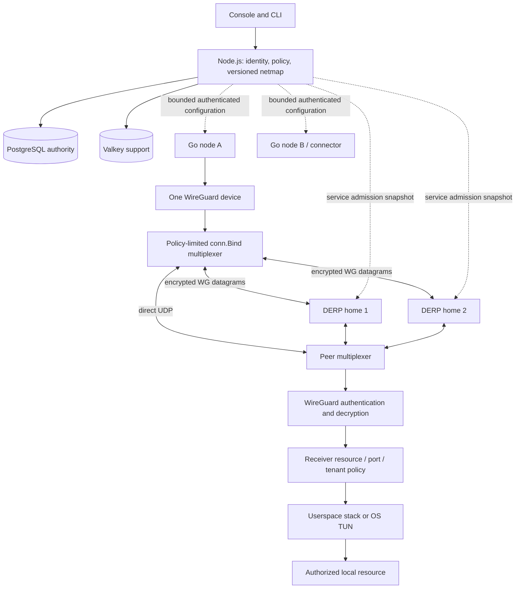

# NeroNet master networking blueprint

Status: proposed extensions; existing accepted ADRs remain authoritative. Source
survey: 29 October 2026. This document selects integration boundaries and delivery
gates. It does not certify the surveyed upstreams or add their features to NeroNet.

## 1. Product destination and baseline

Deliver an installable private mesh for ordinary users, with a simple single-host
profile first and optional high availability later. Keep the Node.js control
plane, PostgreSQL authority, Valkey support services, React console and Go nodes.
Preserve working identity, enrolment, address allocation, receiver-side policy,
recovery and telemetry while improving connectivity. A new networking library is
not permission to replace these authorities.

Baseline source: `2279cf76a3b10a4b918a6377c1f91b308886a1d7`.
[Exact CI](https://github.com/Mohamed-DN/neronet-proxy/actions/runs/40845893938)
completed successfully. Historical isolated-lab evidence includes a 13-node,
156-direction TCP matrix, internal-CA HTTPS, Pebble issuance/renewal and a local
backup/restore drill. These results do not certify NAT diversity, offsite backup,
mobile clients or HA. The local lab was stopped at this survey checkpoint.

The tenant-audit/session candidate and transport T0 candidate are separate,
unpublished work. Neither candidate is the baseline delivered by this document.
See [current roadmap](ROADMAP.md) and the accepted
[transport ADR](adr/0022-modular-transports.md).

| Boundary | Source inspected in the baseline | What it establishes; remaining gap |
|---|---|---|
| WG device and socket | `pkg/dataplane/dataplane.go`, `bind_port.go`, `netstack.go`, `tundev.go` | One wireguard-go device; process-local userspace stack exists. The OS TUN backend is Linux-only and requires `/dev/net/tun`, `CAP_NET_ADMIN` and iproute2. This is not a host-wide Windows VPN. No measured allocation/CPU profile or throughput target yet. |
| Packet ownership and ACL | `pkg/dataplane/filter.go`, `aclfilter.go`, `pkg/acl/`; `cmd/sovereign-node/dataplane.go` | Filter wraps the plaintext device in both directions, before local delivery. Buffer compaction must preserve wireguard-go ownership/index semantics. An optimization must not bypass this boundary. |
| NAT/discovery | `pkg/nat/stun.go`, `ice.go`, `spray.go`; node dataplane setup | STUN, candidate and spray components exist. File presence does not establish their use by the deployed node or successful symmetric-NAT traversal. Probe acceptance and socket ownership require separate reproduction. |
| Relay | `pkg/derp/client.go`, `fallback.go`; `cmd/sovereign-derp-relay/main.go` | Legacy custom path exists; fallback selects `relayURLs[0]`. Authenticated upstream DERP, multiple homes and lifecycle enforcement belong to the existing T0 gate. |
| Path scoring | `pkg/routing/multipath.go` | Score/EWMA/hysteresis component exists. No claim that this selects the actual WireGuard route or aggregates link bandwidth. |
| DNS and proxy | `pkg/dns/magicdns.go`, `gateway.go`; `pkg/bridge/netstack.go`, `sandbox.go`, `socks5.go` | DNS and proxy components exist; userspace overlay dialing exists. A complete resource connector, OS split DNS and Fake-IP lifecycle are separate deliveries. |
| Identity and control | `cmd/sovereign-node/netmap.go`; `console/backend/services/NetmapService.js`, `NodeCredentialService.js`, `SessionAuthority.js` | Existing node credentials, scoped netmap and admission must remain authoritative. A public key identifies a node; it does not authorize a service. |
| Observability | `NativeTelemetry.js`, `NativeMetrics.js`, node `telemetry.go`; `routes/nodes.js` | Native telemetry has a server-issued registration session, node-issued sequence/counter epoch checked against durable server watermarks, server receipt time and exact counters. Some legacy diagnostics still use fallback numbers: those fields are not acceptable inputs to route selection. Per-peer path measurements remain a T0 deliverable. |

This is a bounded architecture/source audit. It is not an exhaustive vulnerability
audit, a heap profile, or a measurement of every dormant module. Suspected defects
must receive a failing behavioral reproduction before a correction is claimed.

## 2. Corrections to the research assumptions

- **Zero-copy is a property of a particular buffer boundary.** Batch syscalls,
  reference-counted buffers and UDP offloads are different techniques. Encryption,
  framing, ownership and asynchronous queues can still require copies. Report
  copies, allocations and CPU for the path actually exercised; do not promise
  full-link zero-copy or transfer another product's speedup to NeroNet.
- **QUIC DATAGRAM is not a reliable byte stream.** Prefer preserving datagram
  boundaries for encrypted WG packets. QUIC streams, KCP and TCP fallbacks have
  different retransmission, congestion, head-of-line and MTU costs. QUIC on UDP
  port 443 cannot cross a network that blocks all UDP.
- **NAT traversal is probabilistic and network-dependent.** AutoNAT detects
  reachability; DCUtR coordinates attempts through a relay. Neither guarantees
  opening every symmetric NAT/CGNAT. Bound probes by destination, rate, ports,
  time and authenticated peer consent; retain an authorized relay path.
- **Authenticated discovery is not access authorization.** Iroh public-key
  dialing and Nebula certificates are references for identity/discovery. They do
  not replace organization/compartment policy, revocation or netmap expiry.
  Signed offline grants need issuer, audience, scope, expiry and revocation rules,
  including an explicit maximum stale-authorization window. Disconnected nodes
  cannot promise immediate revocation; test refresh deadlines, boot/clock rollback,
  stale backup restoration and live-stream termination on expiry.
- **A signature does not make policy stateless.** Trust roots, expiry, key
  rotation, replay handling and revocation remain stateful responsibilities.
  Public discovery may disclose private addresses and organization membership.
- **Fake-IP is optional destination indirection.** `198.18.0.0/15` is benchmarking
  space, not CGNAT; `100.64.0.0/10` is shared address space and already used by the
  mesh. Do not allocate overlapping pools or claim zero latency/no DNS leaks.
  See the [IANA registry](https://www.iana.org/assignments/iana-ipv4-special-registry/iana-ipv4-special-registry.xhtml).
- **eBPF does not remove the remote encrypted network.** Socket hooks/maps can
  accelerate selected Linux-local operations. Rootless operation, kernel
  capabilities, namespace restrictions and the userspace portable fallback have
  separate requirements. No fast path may bypass receiver authorization.
- **Stealth is a maintained behavior, not an undetectability guarantee.** Evaluate
  active probing, observable TLS/QUIC fingerprints, timing and resource abuse.
  SNI passthrough cannot route on an encrypted inner ClientHello without another
  supported routing identity. A TLS router also needs explicit tenant admission.
- **PQC and MFA are separate from transport selection.** A Rosenpass-style PSK
  contribution needs a cryptographic review, rotation/failure semantics and
  interoperability tests. MFA for console login does not prove per-resource
  connection step-up. No new cryptographic protocol is designed here.
- **Failover is not bonding.** Start with one selected authenticated path and
  measured recovery. Concurrent paths introduce reordering, duplication,
  congestion coupling and cost. Multi-hop application routing would also expand
  policy and relay responsibilities; it is not part of initial DERP redundancy.

## 3. Component architecture and contracts

The control plane is coordination, not the mandatory packet router. The radial
console layout must not suggest otherwise. No relay-to-relay network is introduced
by T0. A sender connects to a reachable advertised home of its destination; two
IDs pointing at one process/host are not independent failure domains.

**Separate state machines from I/O without a runtime rewrite.** Keep small Go
selection logic driven by monotonic time, authenticated progress, configuration
generation and explicit events. An executor owns sockets, timers and cancellation.
This adopts the testability goal of Sans-IO without moving the node to Rust or
embedding an entire foreign overlay.

The transport adapter owns encrypted datagrams only: endpoint parsing, bounded
send/receive, MTU, queue ownership, partial-write accounting, close and coherent
reconfigure errors. Policy filtering remains above it. Maintain one read owner per
UDP socket; discovery must not race WireGuard for incoming packets. Inspect the
exact upstream dependency's Bind/endpoint callbacks before relying on an interface
seen in another fork. In particular, the sampled Tailscale endpoint callbacks
`InitiationAwareEndpoint`/`PeerAwareEndpoint` are reference APIs, not an established
capability of NeroNet's pinned upstream wireguard-go dependency. Path confirmation
must correlate authenticated progress with the endpoint and configuration
generation; rewriting a UAPI endpoint with an old handshake is not new evidence.

Selection uses only allowed candidates from the intersection of build,
installation, organization and both nodes. A policy withdrawal closes or retires
the affected sessions/queues; it does not merely change an icon. Unrecognized
contract versions cannot silently become permissive UDP. Last authenticated path,
currently reachable candidates and stale observation are separate states.

Prefer UDP, then use authenticated `derp-v2` pinned to upstream Tailscale
`v1.102.5` under the existing T0 plan; retry a
better allowed path with bounded probes and hysteresis. A raw handshake/cookie or
network endpoint does not authenticate a peer or stop alternative attempts.
Revocation, quarantine, ACL DROP and absolute netmap expiry apply on every path,
including existing connections where the product policy requires termination.

Per-peer observations extend the current Go-generated contract rather than
inventing a second reporting API: authenticated node/session, sequence, counter
epoch, peer, transport, relay, handshake/progress evidence, server receipt time,
freshness, cause and exact decimal counters. WG session counters, transport
ciphertext counters and application payload are different quantities. Missing RTT,
loss or jitter stays unknown. API filtering covers both endpoints and aggregates
before returning data to the console.

**Resource connector.** Build on the existing userspace stack. A resource registry
maps an authorized resource ID to administrator-owned destination names/IPs,
protocols and ports. Resolve and authorize before every local connect, constrain
DNS rebinding/redirects and destination changes, and bound connections, bytes,
idle time and buffers. Do not accept arbitrary destination URLs from a peer.
Revoked or expired grants cannot leave an unrestricted local bridge open.

**DNS.** First prove ordinary internal DNS, split DNS and OS configuration with
the existing resolver. Fake-IP is a later opt-in adapter: tenant-scoped mapping,
reverse lookup, TTL/lease, collision/exhaustion handling, IPv6 behavior and restart
rules are part of its contract. Invalidate node-owned mappings/caches on policy
changes; OS/application caches may retain old answers. Independently authorize
every connect/flow/packet at its enforcement boundary so stale answers and literal
Fake-IP addresses cannot grant access. Prevent a recycled address from redirecting
an old cached name or live flow to a different resource. Test UDP/TCP DNS and
external DoH/DoT behavior rather than assuming resolver interception captures
every application query.

**Ingress.** Keep public ingress distinct from an overlay resource connector and
from an encrypted-datagram DERP relay. An outbound connector may expose only
approved routes. TLS passthrough needs a bounded ClientHello parser, timeout,
unambiguous tenant/hostname mapping and backend destination constraints. Treat
PROXY protocol as trusted-edge metadata only; never as proof of end-user identity.
An SNI name alone is neither authorization nor end-to-end client authentication.

## 4. Seven-pillar gap and adoption decision

| Pillar | Baseline / gap | Preferred extension | Evidence needed to advance |
|---|---|---|---|
| 1. Dataplane and I/O | WG userspace and TUN already exist; no measured hotspot ranking | Profile first; retain Go and gVisor; preserve batching/offloads already supplied by the pinned WG Bind; pool only where ownership is explicit. Linux eBPF later and optional. | CPU/heap/allocs per payload, syscall/batch sizes, MTU and mixed packet sizes on/off for supported OS. Same ACL result on fast and portable paths; concurrency/race and lifetime tests. |
| 2. Multiple transports | UDP measured; legacy relay and dormant obfs are not T0 | Finish UDP/DERP, then QUIC DATAGRAM, obfs and TLS in independent ADR0022 packages. KCP/Brutal remain research candidates. | Actual blocked-network overlay scenario per adapter; capture traffic, framing/MTU, backpressure and partial failures; disabling adapter makes its scenario fail. |
| 3. NAT and routing | STUN/ICE/spray/scoring components not full deployed-path proof | Authenticated candidates, relay-assisted direct upgrade, rebinding, bounded probes; path hysteresis. Bonding and multi-hop later. | Controlled NAT topologies plus independent residential/mobile networks, outage and flow recovery measured; forged probes cannot confirm path; no policy bypass when direct returns. |
| 4. Identity and policy | Existing keys, node credentials, tenants/compartments, epochs/expiry; S1 candidate incomplete | Keep those authorities. Explore short-lived resource grants and step-up MFA after lifecycle closure; PQC as a reviewed optional PSK contributor. | Replay/expiry/rotation, stale restore, issuer/audience/target confusion, tenant move, revoked live streams; real TCP denied/allowed through each transport. |
| 5. DNS and split routing | Resolver/gateway code exists; OS and complete connector coverage open | Internal/split DNS first, optional isolated Fake-IP mapping later; trie/radix only if profile warrants. | No pool overlap, exhaustion/reuse/restart/TTL, A/AAAA/PTR and policy updates; OS route/DNS restore and leak tests with failures. |
| 6. Ingress | Proxy components exist; no certified generic public ingress | Resource connector first; separate TLS passthrough/HTTP ingress module, bounded and tenant-scoped. | Unauthorized local destination never dialed; ECH/unknown SNI/parser failures explicit; public edge compromise cannot grant overlay privileges. |
| 7. Diagnostics and UX | Aggregate native counters implemented; path/RTT provenance incomplete | `netcheck`/doctor-style diagnostics using actual probes, versioned per-peer telemetry and the existing radial console. | Compare UI/API with TCP and captures through every fault; remove observation feed while traffic works and the observation gate must turn red. |

## 5. Incremental work mapped to the existing roadmap

These packages extend P0-P9; they do not create a competing product roadmap.
Each delivery uses `wp/*`, failing reproduction, correction, important removal
mutation, exact source restoration, lead verification, fast-forward/push and
terminal CI for that exact main commit. Networking delivery also requires the
actual process scenario in `scripts/dev/scenarios/overlay.sh`.

| Package | Existing phase / dependency | Scope and exit gate |
|---|---|---|
| NR0 | P0, current work | Finish S1 tenant/session authority, remaining callers, upgrade and real API/browser/traffic. Preserve the unfinished candidate; no broad networking refactor inside this package. |
| NR1 | P1 / ADR0022 T0 | Preserve/reconcile WIP and the approved Tailscale `v1.102.5` pin, generated Go contract and backend mirror, deployable upstream relay, admission snapshots, two authenticated homes, one WG Bind, dynamic policy and authentic observations. Execute the T0 gates below. |
| NR2 | P2 + P3, after NR1 | Installable Windows/Linux clients, DNS/routes/reboot/roaming and userspace resource connector; improve observed-path console. No claim that compiling Go proves mobile providers. |
| Pilot | P4, after P0-P3 and real offsite backup | Reversible everyday-use pilot alongside the owner's existing network; device/service inventory, supported-network cases and explicit rollback. Advanced research does not replace this delivery. |
| NR3 | P1/P2 optimization, after baseline profile | Reproducible UDP/WG/netstack benchmarks; retain existing GSO/GRO when the custom Bind is introduced. Optimize measured copies/allocations and bounded queues with ACL parity. Publish results by platform, without a promised speedup. |
| NR4 | P5/P6, after NR1 | QUIC DATAGRAM and relay-assisted direct upgrade, separately gated. Broader ICE library adoption only if interoperability/maintenance gains outweigh a second candidate state machine. |
| NR5 | P5, after NR2 | Resource-scoped signed grants, connection step-up, outbound connector/ingress and optional Fake-IP. Each is a distinct package with resource lifecycle/revocation and tenant-negative tests. |
| NR6 | P6 | Obfs/TLS, Tor TCP egress and optional degraded-link experiments. Tor remains separate from DERP; no hidden direct fallback, no generic UDP over Tor. Preserve per-organization/build exclusions. |
| NR7 | P7, after P4 and qualified recovery | Single-host remains supported. Optional Patroni/etcd PostgreSQL HA, then API/edge/Valkey/jobs/certificates/relay HA by component. Prove quorum/fencing/one writer and failure domains; replication is not backup. |
| NR8 | P8 | Bonding/multipath, Linux eBPF fast path, multi-hop routing, PQC and scale. Each requires its own ADR, profile/threat model and independent review. No multi-hop in T0. |
| Retained extensions | P9 | Personal cloud, remote desktop, E2EE storage, application catalog, knowledge graph and AI access governance retain separate requirements. Frozen/removed products are not silently reactivated. |

Keep backup offsite, public ACME operation, client signing/upgrades, Android
VpnService, Apple packet-tunnel providers, IPv6, external review, regulated builds
and plugin isolation as separate gates. No feature in this survey removes them.

The T0 integration gates are ordered: (0) wire/build contract and compatible
baseline; (1) authoritative policy and relay admission; (2) deployable authenticated
relay; (3) node/mux policy and roaming; (4) scoped observations; (5) actual Compose
process scenarios and CI. Start relay admission denied, verify TLS trust/SANs,
and independently expire admission snapshots so active sessions close without a
successful refresh. Exercise asymmetric destination homes, primary/all-relay loss,
unknown versions, configuration errors and policy withdrawal of queued receives,
sends and timers. Capture outside the node to detect forbidden or partially sent
batches; a transport counter alone is insufficient. These are required future
proofs, not results established by source inspection.

## 6. Validation and benchmark contract

Record source/dependency versions, images, OS/kernel, CPU topology, privileges,
link rate, RTT, jitter, loss, reordering, MTU, queue limits and topology. Compare
the same authenticated peers/policy and payload on portable/optimized paths.
Measure delivered goodput, p50/p95/p99 application latency, failure/recovery window,
CPU, memory, allocations, descriptors, goroutines, dropped/duplicate packets and
wire bytes. Raw cipher throughput is not application goodput.

Start with direct UDP and real two-relay fallback before adding impairment sweeps.
For optional link experiments, include 0/1/5/10/20/30 percent controlled loss and
competing ordinary TCP/QUIC flows; distinguish emulated loss from congestion.
These are proposed test points, not known tolerances or promised results.

Cover NAT remapping, all relays lost, control unavailable until configuration
expiry, cancellation, small/oversized datagrams, partial sends, reconnect storms,
backpressure and repeated start/stop. A deterministic simulated clock tests the
state machine; real sockets/processes and external filters/captures prove the
deployed behavior. Fault helpers are confined to dedicated projects/port offsets
and restore their exact changes. Owner volumes and other applications are excluded.

The console uses straight, unobtrusive paths and selected neighborhoods, clear
groups, keyboard/list alternatives, light/dark themes, IT/EN and reduced motion.
Policy edges and observed paths remain separate. Simulated 100/1,000-node fleets
measure UI behavior only, not that many live tunnels.

## 7. Source-by-source comparison and provenance

See [source comparison](research/NETWORK_SOURCE_COMPARISON.md) for exact pinned
files, algorithms, component license evidence and NeroNet integration boundaries.
The machine-readable [source index](research/NETWORK_SOURCE_INDEX.json) records
retrieval digests. A downloaded file is not automatically a reviewed algorithm;
coverage gaps remain explicit. Upstream runtime tests were not executed.

Prefer narrow dependency adapters and preserve applicable notices. Inspect
component and transitive licenses before code reuse; do not infer permissive
terms from a repository badge. NeroNet's own root license is AGPL-3.0. Source
availability alone does not imply permission to reuse enterprise components.

The research request included several independent families: KCP, Brutal,
Salamander, REALITY, Vision, AutoNAT/DCUtR, certificate policy, PQC, fake-IP,
rootless ingress, stream multiplexing, eBPF, link bonding and public-key discovery.
Their presence in this document is an explicit backlog, not an implementation
claim. Unknowns and uninspected subfeatures must be closed before their package
can be considered ready for implementation.
